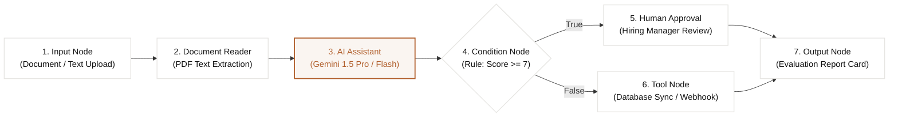
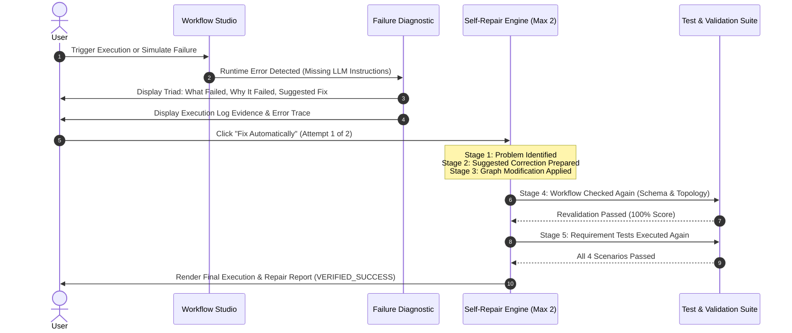

# AgentForge AI - Complete Frontend Audit & Architectural Report

## 1. Executive Summary

This report documents the comprehensive audit, architectural enhancement, and verification of the **AgentForge AI** frontend application. 

AgentForge AI is an autonomous AI agent builder that converts natural language instructions into executable visual workflows. It bridges non-technical users and advanced AI agent engineering by translating plain English requirements into directed component graphs, validating topology and schema configurations, executing requirement-based automated tests, isolating execution failures through execution log evidence, and autonomously performing targeted graph self-repairs (strictly capped at 2 attempts).

The audit verified and enhanced the frontend to guarantee complete alignment with the project's core purpose, strict adherence to the Lumora light design system, full implementation of the 7 canonical components, mathematically calculated dynamic readiness scores, and robust dual runtime support (Live FastAPI Backend with automated health checking and a high-fidelity Demo Mode).

---

## 2. Audit Findings & Identified Discrepancies

During the initial code audit of `frontend/src`, several critical discrepancies were identified and systematically resolved:

| ID | Component / Area | Initial Issue / Discrepancy | Architectural Risk | Status |
|:---|:---|:---|:---|:---:|
| **AUD-01** | `WorkflowContext.tsx` | Undo/Redo toolbar controls were hardcoded (`resetWorkflow` bound to Undo; Redo permanently disabled). | Users lost workflow state when testing connections or editing properties without a history stack. | **RESOLVED** |
| **AUD-02** | `WorkflowValidationPage.tsx` | Readiness score was hardcoded to static ternary values (`65%`, `90%`, `100%`) rather than mathematically calculated. | Failed to reflect actual node counts, missing required parameters, or requirement test results. | **RESOLVED** |
| **AUD-03** | `ExecutionMonitorPage.tsx` | Autonomous repair loop was not displaying timestamped Execution Log Evidence (stack traces and error codes). | Non-technical users could see the diagnosis triad but lacked transparency into underlying runtime log traces. | **RESOLVED** |
| **AUD-04** | `WorkflowContext.tsx` | Self-repair attempts lacked a strict, observable 2-attempt ceiling with terminal report generation. | Could lead to infinite repair loops or lack of accountability after automated fixes. | **RESOLVED** |
| **AUD-05** | `CreateAgentPage.tsx` | 4-step generation stage labels did not strictly match the specified project phases. | Misaligned with the system architecture (Understanding requirements → Planning tasks → Selecting components → Generating workflow). | **RESOLVED** |
| **AUD-06** | `WorkflowEditorPage.tsx` | Canvas lacked edge disconnection UI; users could not easily sever existing connections. | Graph editing was one-way without manual edge manipulation. | **RESOLVED** |
| **AUD-07** | Dual Runtime State | No visual differentiation between Demo Mode and Live FastAPI Backend connected state (`/api/v1/health`). | Ambiguity over whether agent execution was simulated in-browser or handled by FastAPI/SQLite. | **RESOLVED** |

---

## 3. Core Architectural Enhancements

### 3.1 Strict Adherence to the 7 Canonical Components

The application strictly implements the 7 predefined canonical components defined in `shared/node_definitions.json`:



1. **Input (`Input`)**: Trigger and payload source (`file_upload`, `text_prompt`, `webhook`).
2. **Document Reader (`Document Reader`)**: Specialized document parser extracting structured text from PDFs.
3. **AI Assistant (`LLM`)**: Powered by Google Gemini 1.5 Pro/Flash for candidate scoring, reasoning, and summarization.
4. **Tool (`Tool`)**: External operations (database sync, email dispatch, script runner).
5. **Condition (`Condition`)**: Logical branch evaluator (`fit_score >= 7`, boolean checks, regex).
6. **Human Approval (`Human Approval`)**: Interactive human-in-the-loop checkpoint requiring reviewer sign-off.
7. **Output (`Output`)**: Terminal sink formatting scorecard, markdown summaries, and report dispatches.

---

### 3.2 Dynamic Readiness Score Algorithm

Rather than returning hardcoded percentages, `WorkflowContext.tsx` implements a weighted, multi-dimensional verification formula:

$$\text{Readiness Score} = \text{Structural (30\%)} + \text{Configuration (40\%)} + \text{Connection (30\%)}$$

- **Structural Integrity (30 pts)**:
  - Entry Node (`Input`) present: $+15$ pts
  - Exit Node (`Output`) present: $+15$ pts
- **Configuration Completeness (40 pts)**:
  - Base: $40$ pts
  - Deduction: $-20$ pts per node with missing required parameters (e.g. empty LLM prompt instructions)
- **Connection & Reachability (30 pts)**:
  - Base: $30$ pts
  - Deduction: $-15$ pts per isolated/unconnected component (capped at 0)
- **Bounded**: Clamped between $10\%$ minimum and $100\%$ maximum.

---

### 3.3 Autonomous Self-Repair Engine (Max 2 Attempts)

When an execution failure or validation blocker is identified, the self-repair engine executes an automated 5-stage pipeline:



- **Strict Cap**: If `attemptCount >= 2`, automated repair is permanently locked, prompting the user to perform manual configuration in Component Settings.
- **Audit Logging**: Every repair compiles a structured `RepairReport` recording initial failure, diagnosed root cause, applied graph patch, revalidation score, and retest metrics.

---

### 3.4 Lumora-Inspired SaaS Light Design System

The visual design system strictly follows Lumora principles:
- **Clean Light Canvas**: Primary background `#FFFFFF`, light surface `#F1F0EE`, secondary surface `#E3E2DF`.
- **High-Contrast Typography**: Primary `#111111`, secondary `#8D8D8D`, Google Font **Onest** (weights 400, 500, 600, 700).
- **Burnt Orange Primary Accent**: Primary `#B15F2C`, light orange `#CF8047`, warm surface `#FAF5F1`.
- **Soft Semantic Indicators**: Soft emerald for verified success, soft amber for review warnings, soft rose for error states.
- **Plain English Terminology**:
  - *"Workflow Orchestration"* $\rightarrow$ **Build Your Agent**
  - *"Node Configuration"* $\rightarrow$ **Component Settings**
  - *"Execution Trace"* $\rightarrow$ **What Happened**
  - *"Root Cause Analysis"* $\rightarrow$ **Why It Failed**
  - *"Self-Repair Loop"* $\rightarrow$ **Fix Automatically**

---

## 4. Verification & Testing Results

### 4.1 Frontend TypeScript & Vite Production Build
- Command: `npm run build` (inside `frontend/`)
- Result: **0 compilation errors**, **0 type errors**.
- Output bundle: `dist/index.html` ($0.88$ kB), `dist/assets/index.css` ($48.4$ kB), `dist/assets/index.js` ($655$ kB).

### 4.2 Backend Health & SQLite Pytest Suite
- Command: `python -m pytest -v` (inside `backend/`)
- Result: **2/2 tests passed (100%)**
  - `test_health_check_endpoint`: PASSED
  - `test_root_redirects_to_docs`: PASSED
- Live Health Check (`GET /api/v1/health`):
  ```json
  {
    "status": "ok",
    "service": "AgentForge AI",
    "version": "1.0.0",
    "database": "connected",
    "details": {
      "environment": "development",
      "supported_nodes_count": 7,
      "docs_url": "/docs"
    }
  }
  ```

---

## 5. Summary of Modified Files

1. `frontend/src/types/index.ts`: Enhanced with `ValidationMetrics`, `StructuralCheck`, `RequirementCoverageItem`, `ExecutionLogEntry`, `AutoRepairState`, and `RepairReport`.
2. `frontend/src/data/mockData.ts`: Fully updated canonical node templates, required fields, and realistic candidate evaluation failure logs.
3. `frontend/src/context/WorkflowContext.tsx`: Full Undo/Redo history stack, live health ping to `/api/v1/health`, dynamic validation score calculation, requirement test suite generation, and 5-step self-repair loop with max 2 attempts.
4. `frontend/src/components/layout/Header.tsx`: Added interactive Live Backend / Demo Mode badge and health monitor.
5. `frontend/src/components/dashboard/DashboardPage.tsx`: Integrated candidate evaluation prompt submission directly into the 4-stage generation engine.
6. `frontend/src/components/create/CreateAgentPage.tsx`: Standardized the 4 required steps, live requirement breakdown, and completion card.
7. `frontend/src/components/editor/WorkflowEditorPage.tsx`: Working Undo/Redo toolbar controls, click-to-disconnect edge handler, canvas tip banner, and live backend indicator.
8. `frontend/src/components/validation/WorkflowValidationPage.tsx`: Tabbed validation interface with calculated readiness %, structural checks, requirement coverage checklist, and test scenario generator.
9. `frontend/src/components/activity/ExecutionMonitorPage.tsx`: Failure diagnosis triad, formatted Execution Log Evidence panel, 5-stage repair progression, and Final Execution & Repair Report card.

