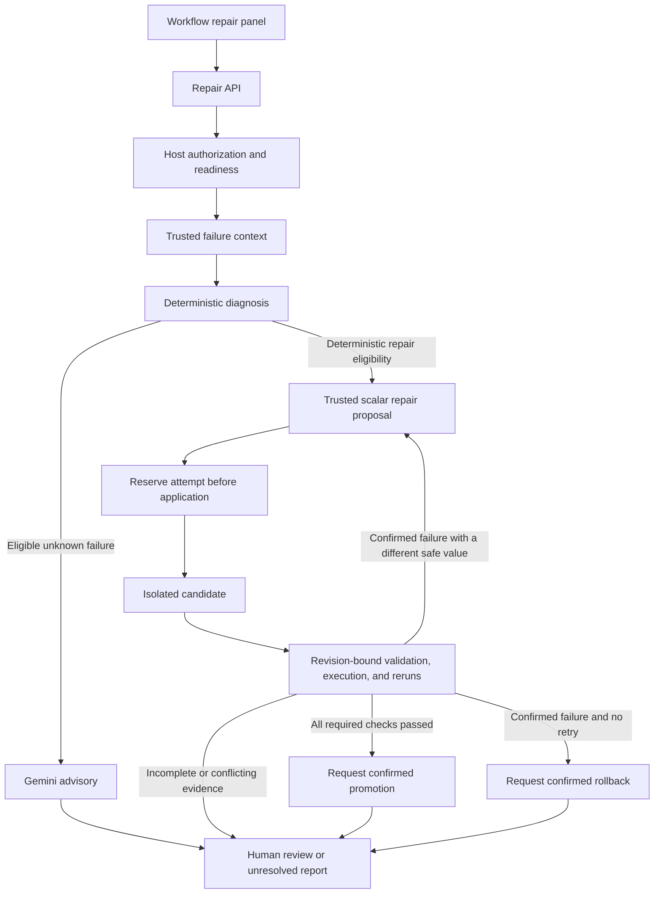

# Member 6 · Failure Diagnosis and Self-Repair

AgentForge needs to identify a failed workflow node and safely repair a supported
setting without changing the original revision or redefining success. Member 6
owns diagnosis, planning, candidate isolation, verification coordination, repair
policy, and reporting. The team owns workflow storage, generation, execution, and
the test engines behind the integration contracts below.

## Architecture



[The recovery graph reference](REPAIR_RECOVERY_GRAPH.md) describes the graph state
and terminal outcomes. The API checks production readiness and claims the request
with Member 1 before entering the graph. A test or demo can invoke the compiled
graph with fixture adapters. The public API has no fixture fallback.

- **Deterministic diagnosis** uses error codes, a uniquely identified node, and
  an approved field definition. It distinguishes a missing key, explicit null,
  and disallowed blank strings from valid values such as `false` and `0`.
- **Gemini** receives only allowlisted facts for eligible unknown failures.
  Known failures and contradictory context stay local. Gemini's structured
  hypothesis is advisory and cannot authorize changes or supply replacement data.
- **Planning** supports one operation, restoring a required scalar setting from
  an authenticated working revision. Empty required instructions qualify only
  under an approved exact field policy. Filling in invented prompts, restoring
  nonmissing values, editing protected fields, and repairing edges or mappings
  are outside the supported policy.
- **Candidate application** checks workflow, revision, node, field, original
  presence and value, policy, and replacement provenance. It modifies a deep
  copy and checks the complete document diff. The original and its test
  definitions remain unchanged.
- **Attempts** are capped at two, with an additional graph recursion limit.
  Production claims the run once and reserves each attempt atomically before
  application. An application failure consumes the reservation. A retry
  requires a confirmed failure and a different trusted value for the same field.
  With durable reservation unavailable, automatic production recovery is blocked.
- **Verification and lifecycle** require evidence for the exact candidate, a
  distinct execution run, structural success, and all original failed and
  previously passing test reruns. Promotion and rollback require a confirmed
  active-revision comparison. Missing evidence yields an unavailable outcome.
  Recording errors are reported and do not undo a confirmed lifecycle action.

## API and frontend

| Route | Request | Response |
|---|---|---|
| `GET /api/v1/repair/readiness` | No body | Diagnosis and recovery readiness, two-attempt limit, dependencies, and blockers. |
| `POST /api/v1/repair/diagnose` | Workflow, revision, and execution run IDs | Deterministic diagnosis or advisory, with a safe explanation. |
| `POST /api/v1/repair/recover` | Same three IDs | Synchronous result with candidate references, attempts, verification, promotion or rollback, and recording status. |

```json
{
  "workflow_id": "workflow-uuid",
  "workflow_revision_id": "revision-uuid",
  "execution_run_id": "run-uuid"
}
```

The route uses the existing API prefix. The host supplies an authorization
adapter and a server-side source of failure evidence. The public readiness
response exposes availability only. Requests and reports carry no workflow
payload, credential, replacement value, or raw exception log. Extra request
fields produce a sanitized `422` and repair responses use `Cache-Control:
no-store`. Authorization denial returns `403`, missing evidence `404`, and
duplicate claims, stale revisions, and exhausted durable budgets `409`.
Unavailable dependencies or proof return `503`. Safely evaluated business
outcomes such as human review and confirmed rollback return `200`. The
synchronous response is the current report delivery path. A persistent report
lookup route can be added once storage, retention, and read authorization are
agreed.

In the Execution Monitor, open **Workflow repair**. The panel shows readiness
and, when diagnosis is configured, accepts IDs issued by the backend. It shows
loading while the request is in flight and renders the returned evidence. The
editor and validation repair controls open this panel. The repair code never
changes the editor graph, execution history, or Reliability Lab results. The
surrounding execution and testing demos belong to their respective team modules.

## Team integration handoff

Register the services during host setup.

```python
from app.services.repair.integration import RepairBindings, RepairService

# Supply real implementations owned by the team.
app.state.repair_service = RepairService(RepairBindings(
    access=access, failures=failures, requirements=requirements, policies=policies,
    replacements=replacements, snapshots=snapshots, attempts=attempts,
    verifier=verifier, lifecycle=lifecycle, recorder=recorder,
))
```

The default binding is empty. The host can mark a bound dependency
`unavailable`, `incompatible`, or `requires_human_intervention` in
`RepairBindings.availability`. An absent binding is `not_configured`.
`available` means the host supplied the interface. Each request still validates
the evidence and revision and checks atomic operations.

| Owner | Interface and signature | Input and output guarantees | Current availability |
|---|---|---|---|
| 1 | `RepairAccess.allows(request, scope, action) -> bool` | Use the authenticated host principal. Check workflow and run access and the requested diagnose or recover permission. Denial precedes failure lookup. | Production binding pending. |
| 1 | `SnapshotSource.save_snapshot(workflow_id, revision_id) -> WorkflowSnapshot \| None` | Return immutable JSON for the exact revision. Signal stale active revisions with `RevisionConflict`. CRUD rows alone do not provide this. | Pending durable revisions. |
| 1, with 3 | `ReplacementProvider.get_replacement(target) -> TrustedReplacement \| None` | Return an allowed scalar and provenance for the same workflow, node, field, and schema with the authenticated working source revision. | Pending working revision storage and field approval. |
| 1 | `DurableAttempts.begin(scope) -> AttemptReservation` | Atomically claim the workflow, revision, and run once. Return `conflict` for concurrent or completed duplicate requests. | Production implementation pending. |
| 1 | `DurableAttempts.reserve(scope, number, *, limit) -> AttemptReservation` | Atomically reserve the exact next attempt and enforce the supplied bound across workers and crashes. Return `limit_reached`, `conflict`, or `unavailable` when reservation cannot proceed. | Production implementation pending. |
| 1 | `DurableAttempts.finish(scope, result) -> None` | Persist terminal state without unlocking duplicate recovery. Define crash reconciliation so an interrupted claim never spends an extra attempt. | Production implementation pending. |
| 1 | `RevisionLifecycle.find_last_working_snapshot(workflow_id) -> WorkflowSnapshot \| None` | Return a revision with authoritative passing evidence for the same workflow. | Production implementation pending. |
| 1 | `RevisionLifecycle.promote_candidate(candidate, *, expected_revision_id) -> RevisionUpdate` | Persist the verified candidate and atomically compare and update the active revision. Confirm only after commit. | Production implementation pending. |
| 1 | `RevisionLifecycle.restore_snapshot(snapshot, *, expected_revision_id) -> RevisionUpdate` | Atomically restore the known working revision or return `conflict` if a newer edit exists. | Production implementation pending. |
| 1 | `RecoveryRecorder.record_attempt(original, execution_run_id, attempt) -> None` and `record_outcome(result) -> None` | Persist safe summaries. Use idempotent writes keyed by scope and attempt number. Raise on persistence failure. | Production implementation pending. |
| 2 | `RequirementsSource.get_original_requirements(workflow_id, revision_id) -> OriginalRequirements` | Return original requirements and immutable acceptance criteria using stable IDs. Coordinate the server Gemini key and separate diagnosis model. | Production implementation pending. |
| 3 | `RepairBindings.policies: Mapping[str, tuple[ScalarFieldPolicy, ...]]` | Approve the exact layout, revisioned schema ID, required field, type, allowed value constraints, and permissions. Resolve `data.config.instructions` versus `config.systemPrompt` before enabling a rule for either layout. | Shared catalog exists. Approved binding pending. |
| 4 | `FailureSource.get_failure(scope) -> tuple[FailureInformation, DiagnosisContext] \| None` | Load matching workflow, revision, run, and node evidence. Use structured error codes and redacted facts. External diagnosis needs explicit clearance. | Execution telemetry exists on the CRUD branch. Trusted failure source pending. |
| 4 | `WorkflowExecutor.execute_candidate(candidate) -> CandidateExecution` | Execute the supplied immutable candidate in isolation and return a distinct revision-bound run. Preserve approvals and external-action restrictions. | Production engine pending. |
| 5 | `RecoveryVerification.get_baseline(workflow_id, revision_id, execution_run_id) -> VerificationBaseline \| None` | Supply failed test IDs and previously passing test IDs with immutable definition revision IDs. | Production baseline pending. |
| 4 and 5 | `RecoveryVerification.verify(candidate, baseline) -> CandidateEvidence \| None` | Validate the exact candidate, run it in isolation, and rerun original failed and regression cases with the same inputs and assertions. Bind every check to the candidate and original baseline. Return unavailable evidence if any required dependency cannot run. | Production execution, validation, and rerun adapters pending. |

## Setup and demonstration

Run the backend with Python 3.11 from `backend/`. Install
`requirements.txt` and `requirements-langgraph.txt` in that environment.
Gemini is optional. For a separate environment, install the same files together
with `requirements-gemini.txt` so the resolver can select mutually compatible
dependencies. Keep `GEMINI_API_KEY` and `GEMINI_DIAGNOSIS_MODEL` in server
environment settings. A model must explicitly support structured output. The
demo has no credential requirement.

```text
python -m examples.member6_demo
```

| Scenario | Fixture result |
|---|---|
| A · Restore the missing output format | Candidate passed synthetic checks and the fixture confirmed promotion. One attempt. |
| B · Missing credentials | Human review. Zero attempts. |
| C · Candidate regression failed | Identical correction declined and the fixture confirmed rollback. One attempt. |
| D · Production dependencies absent | Recovery blocked. Zero attempts. |
| E · Older revision requested | Revision conflict rejected. Zero attempts. |

After separate approval, an optional live check uses only a synthetic output
shape observation and prints an outcome without printing the response or key.

```text
python -m examples.member6_gemini_smoke --live
```

## Verification and limits

- Backend from `backend/` with isolated in-memory SQLite and cache writes
  disabled. `python -B -m pytest -q -p no:cacheprovider` passed 255 tests.
- Frontend from `frontend/`. `node --experimental-strip-types --test
  tests/repairApi.test.mjs` passed 4 tests. `npm run build` passed TypeScript
  and the Vite build. Browser interaction was outside these checks.
- An isolated environment imported Google Gen AI SDK 1.75.0 with LangGraph
  1.2.24 and passed `pip check`. Production packages in the project
  environment were preserved. Live Gemini connectivity remains unverified.
- Production self-healing depends on the adapters above. Demonstration
  promotion and rollback are fixture outcomes. Retry coordination for real
  duplicate requests needs a durable adapter. The planner still supports only
  approved missing-scalar restoration.
