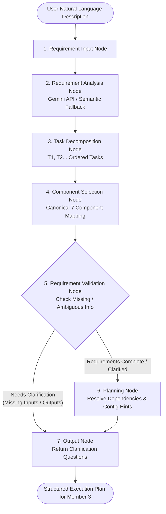

# Member 2: AI Requirement Analysis & Agent Architect
### AgentForge AI Backend Architecture & Implementation Guide

---

## 1. Executive Summary

**Member 2** of the AgentForge AI platform is responsible for the **AI Requirement Analysis & Agent Architect** module. This system translates natural-language user descriptions into structured, ordered, and validated execution plans suitable for direct ingestion by Member 3 (Workflow Generation Module).

---

## 2. Core Capabilities

1. **Natural Language Understanding (NLU)**:
   - Understands user objectives, data domains, input triggers, and expected deliverables.
   - Extracts processing operations, tools, and execution constraints.

2. **Hierarchical Task Decomposition**:
   - Deconstructs high-level objectives into sequential executable tasks.
   - Assigns unique `task_id` (T1, T2...), `task_name`, `description`, `input`, `expected_output`, `dependencies`, and `execution_order`.

3. **Strict Canonical Component Mapping**:
   - Maps each task to one of the 7 supported canonical components (`shared/node_definitions.json`):
     1. `Input`
     2. `LLM`
     3. `Document Reader`
     4. `Tool`
     5. `Condition`
     6. `Human Approval`
     7. `Output`
   - Normalizes component aliases and strictly rejects unsupported component types.

4. **Ambiguity Detection & Clarification Question Generation**:
   - Detects incomplete or underspecified prompts (e.g. missing inputs, missing output specifications).
   - Generates targeted clarification questions with explicit explanations of why clarification is needed.
   - Allows users to provide answers to resolve ambiguities into a `ready` execution plan.

5. **Google Gemini API Integration**:
   - Secure server-side execution reading API key from `settings.GEMINI_API_KEY`.
   - Structured JSON output with JSON parsing from markdown codeblocks.
   - Handles timeouts, rate limits (HTTP 429), authorization errors, and model fallbacks.
   - Includes a deterministic semantic engine that operates 100% offline for local development and automated testing without requiring a live API key.
   - Transparently flags whether the plan was generated by `"google-gemini"` or `"deterministic_engine"`.

6. **LangGraph StateGraph Implementation**:
   - Coordinates the 7-stage planning process using a compiled LangGraph `StateGraph`:
     1. `requirement_input`
     2. `requirement_analysis`
     3. `task_decomposition`
     4. `component_selection`
     5. `requirement_validation`
     6. `planning`
     7. `output`
   - Features dynamic conditional routing: routes to `planning` if requirements are complete, or directly to `output` if clarification questions must be answered by the user.

---

## 3. Architecture & LangGraph Flow



---

## 4. API Specification

### Endpoint: `POST /api/v1/agents/analyze`

#### Request Body:
```json
{
  "description": "Create an AI agent that reads PDF resumes, extracts candidate skills, compares them with a job description, and generates an evaluation report.",
  "clarification_answers": {}
}
```

#### Response Body (`200 OK`):
```json
{
  "project_objective": "Evaluate candidates using resumes and job descriptions",
  "status": "ready",
  "requirements": {
    "inputs": ["PDF resume", "Job description"],
    "processing": [
      "Extract resume information",
      "Extract candidate skills",
      "Analyze job description",
      "Compare candidate skills",
      "Evaluate candidate suitability"
    ],
    "outputs": ["Candidate evaluation report"],
    "tools": [],
    "constraints": ["Ensure schema adherence and execution safety"]
  },
  "tasks": [
    {
      "task_id": "T1",
      "task_name": "Upload Resume",
      "description": "Ingest user-provided source files or parameters.",
      "component": "Input",
      "component_type": "Input",
      "required_component": "Input",
      "input": "User upload trigger / files",
      "expected_output": "Raw uploaded file references",
      "dependencies": [],
      "execution_order": 1,
      "component_config_hints": { "inputType": "file_url", "required": true }
    },
    {
      "task_id": "T2",
      "task_name": "Extract Resume Data",
      "description": "Parse text, tables, and metadata from incoming files.",
      "component": "Document Reader",
      "component_type": "Document Reader",
      "required_component": "Document Reader",
      "input": "File from T1",
      "expected_output": "Parsed text and structured entity chunks",
      "dependencies": ["T1"],
      "execution_order": 2,
      "component_config_hints": { "supportedExtensions": [".pdf", ".docx"], "extractTables": true }
    },
    {
      "task_id": "T3",
      "task_name": "Analyze and Compare Skills",
      "description": "Apply Gemini LLM reasoning to evaluate context against target criteria.",
      "component": "LLM",
      "component_type": "LLM",
      "required_component": "LLM",
      "input": "Extracted data from T2",
      "expected_output": "Structured analysis, scores, and evaluation insights",
      "dependencies": ["T2"],
      "execution_order": 3,
      "component_config_hints": { "model": "gemini-1.5-pro", "temperature": 0.3 }
    },
    {
      "task_id": "T4",
      "task_name": "Generate Evaluation Report",
      "description": "Format and deliver the final output report or payload.",
      "component": "Output",
      "component_type": "Output",
      "required_component": "Output",
      "input": "Synthesized outputs from T3",
      "expected_output": "Formatted final deliverable",
      "dependencies": ["T3"],
      "execution_order": 4,
      "component_config_hints": { "format": "markdown_report" }
    }
  ],
  "required_components": ["Input", "Document Reader", "LLM", "Output"],
  "clarification_questions": [],
  "confidence_score": 0.95,
  "architecture_summary": "Execution plan for 'Evaluate candidates using resumes and job descriptions' with 4 ordered tasks utilizing components: Input, Document Reader, LLM, Output.",
  "ai_provider": "google-gemini",
  "model_used": "gemini-1.5-pro",
  "contract_version": "1.0.0"
}
```

---

## 5. Environment Configuration

In `.env`:
```ini
# Google Gemini API Key (Server-side only)
GEMINI_API_KEY=your_gemini_api_key_here

# Configurable Default Model
GEMINI_DEFAULT_MODEL=gemini-1.5-pro
```

---

## 6. Testing

Run the automated test suite:
```bash
python -m pytest backend/tests/test_requirement_analysis.py -v
```

All 11 Member 2 tests run without requiring a live Gemini API key, using mock patches and the built-in deterministic semantic engine.
