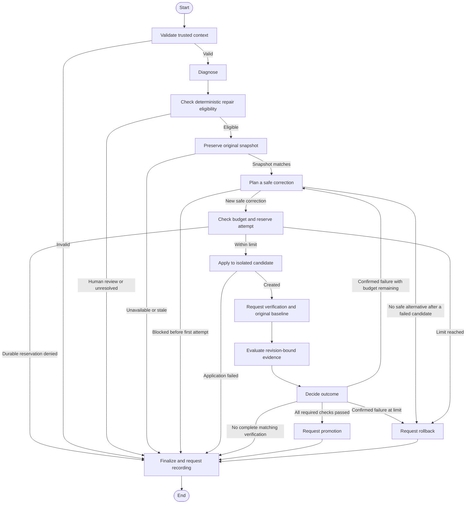

# Member 6 recovery graph

See [Member 6 implementation and team handoff](MEMBER6_IMPLEMENTATION.md) for
the API, production readiness, and durable reservation adapter.

Phase 5 compiles a LangGraph `StateGraph` for one recovery invocation. It calls
the existing deterministic-first diagnosis router and scalar or named-connection repair planner.
Snapshot, verification, promotion, rollback, and recording adapters are injected.
The graph tests use the real LangGraph runtime with test-only adapters. There is
no production checkpointer or active-revision store in this phase.

## State and attempt history

The typed state carries workflow, revision, and run identifiers. It tracks the
diagnosis outcome and provider usage, eligibility, snapshot and candidate
references, proposal reference, attempt count and history, verification evidence
and decision, promotion or rollback confirmation, retry stop reason, and terminal
result. The attempt reference identifies the target, operation, and source
revision. The verification evidence contains structural, execution, failed-test,
and regression outcomes.

Full graphs, proposal values, the failure record, trusted diagnostic context,
and original requirements stay in the private per-run runtime context. The
candidate is serialized once into an immutable snapshot with a distinct revision
ID. Graph state keeps the candidate reference. Raw provider exceptions and
credentials are excluded from state and outcomes. The recovery entry point
disables LangSmith tracing. The in-memory candidate cannot be resumed from the
returned reference after the invocation ends.

An attempt begins when `reserve_attempt` increments the count and adds an
attempt record, before application. Application failures, invalid verification
evidence, and confirmed verification failures consume that attempt. Only a
confirmed verification failure can return to planning. The next proposal must
offer a different trusted value for the same field on the original snapshot.
Graph plans compare the complete candidate digest across attempts. Changing provenance alone cannot trigger another application of a rejected value.
The graph shares `MAX_AUTOMATIC_REPAIR_ATTEMPTS` with the repair contracts and
also imposes a 32-step LangGraph recursion limit. Durable attempt limits across requests, concurrent workers, and restarts require the Member 1 persistence adapter.

## Verification and revision adapters

- **SnapshotSource** supplies the exact original revision or signals a revision
  conflict. The planner still checks the graph fingerprint and all original
  safety preconditions.
- **RecoveryVerification** retrieves immutable test-definition revision
  references for the original failed run. It verifies the exact candidate
  against that same baseline across all attempts. The graph requires structural
  validation, a distinct candidate execution run, and all baseline failed and
  previously passing tests to pass for success. Missing or mismatched evidence
  stops with verification unavailable and leaves the original active.
- **RevisionLifecycle** promotes verified candidates or restores a working
  snapshot. Both operations must atomically compare the expected original
  revision to the active revision and return a typed confirmation or conflict.
  A verified candidate without promotion confirmation has its own status.
- **RecoveryRecorder** receives attempt and final outcome summaries. Recording
  failure is reported separately from the lifecycle decision. These calls do
  not reserve attempts durably.

## Terminal outcomes

| Condition | Terminal status |
|---|---|
| Missing or contradictory context | `invalid_context` |
| Advisory Gemini finding or a deterministic manual-review decision | `human_review` |
| Insufficient diagnosis evidence | `unresolved` |
| Snapshot unavailable or blocked planning/application | `snapshot_unavailable`, `plan_blocked`, or `application_failed` |
| Missing adapter, incomplete or mismatched verification | `verification_unavailable` |
| Verified candidate with no promotion adapter | `verified_pending_promotion` |
| Confirmed promotion or unconfirmed promotion failure | `promoted` or `promotion_failed` |
| Active revision changed before snapshot, promotion, or rollback | `revision_conflict` |
| Failed candidates and no available rollback adapter or working revision | `repair_failed` |
| Working revision restored or restoration failed | `rolled_back` or `rollback_failed` |
| Unexpected graph failure | `graph_error` |

For example, the successful fixture restores `outputFormat` on a candidate.
Its verifier binds passing structural, execution, failed-test, and regression
checks to that candidate revision. Its lifecycle adapter confirms promotion.
The regression-failure fixture returns to planning and declines the same
replacement even if the source revision changed. It requests restoration of
the fixture working revision and reports `rolled_back` only on confirmation.

## Production integration

Member 1 needs to supply immutable workflow revisions, idempotent and atomic
attempt reservation, promotion and rollback updates, and recording. Member 2
supplies original requirements, Member 3 approves graph field layouts and
replacement policy, and Members 4 and 5 supply authoritative candidate execution,
immutable test baselines, and real rerun evidence. The production verifier must
run candidates in isolation and bind every check to the candidate and baseline.
Neither Gemini advice nor a candidate file is verification evidence.

## Named connections and stored results

The graph accepts only deterministic diagnoses on the connection path. A missing graph authority leads to human review. Planning compares the expected failed graph to a verified working revision, reversing the permitted difference for the whole-document comparison. After reservation, application reads the authority again, rebuilds a detached candidate and checks its digest against that working document. The graph uses the same attempt counter and verification, promotion and rollback gates as scalar recovery.

When the host supplies `Member5StructuralValidation`, the coordinator calls the published validator on the exact serialized candidate before candidate execution. A confirmed structural failure consumes the reserved attempt. A missing or inconsistent response stops verification. A passing structural report still requires the original baseline, distinct execution and complete rerun evidence.

The recorder writes terminal events through Member 1. The history reader independently authorizes each scope, bounds retrieval, checks revision associations and verifies the available terminal evidence before presentation. The public API has no fixture fallback. See [completion evidence](MEMBER6_COMPLETION.md).
