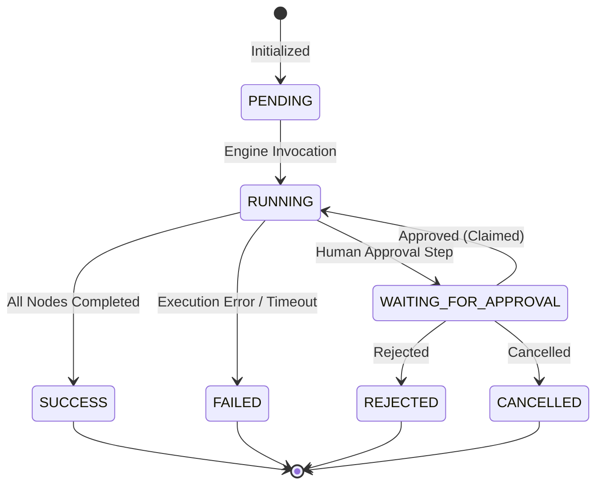

# AgentForge AI – Member 4: Workflow Execution Engine Documentation

## 1. Executive Summary

This document details the architecture, implementation, node handlers, execution state management, security boundaries, performance monitoring, team integration adapters, and FastAPI endpoints for the **Workflow Execution Engine** (Member 4) inside AgentForge AI.

The execution engine translates visual directed workflow graphs into deterministic, asynchronous execution pipelines, handling:
- Multi-node dependency resolution and topological ordering using Kahn's algorithm.
- Cycle detection raising `CycleDetectedError`.
- Data passing across connected input/output handles with dictionary key merging.
- Conditional branching with automatic pruning of untaken paths while preserving diamond/convergent joins.
- Asynchronous Human-in-the-Loop approval gates with immutable workflow snapshotting, checkpointing, and resume/reject/cancel lifecycle.
- Prevention of concurrent or duplicate approval actions via atomic status claims.
- High-precision performance monitoring tracking cumulative durations, per-node latency, external API call counts, and token usage.
- Strict security controls: path traversal blocking, allowlisted document roots, outbound HTTP SSRF filtering (blocking loopback, private ranges, metadata IPs), and sensitive field redaction.
- Decoupled integration adapters for Member 3 (visual graph schemas), Member 5 (Reliability Lab `IWorkflowExecutor`), and Member 6 (Self-Repair failure evidence & isolated candidate execution).

---

## 2. 10-Stage Execution Engine Architecture

```
+-------------------------------------------------------------------------------+
|                      STAGE 1: RECEIVE WORKFLOW & INPUTS                       |
|   - Ingests workflow JSON topology and initial runtime input payload.         |
|   - Computes deterministic immutable revision ID (SHA256).                    |
+-------------------------------------------------------------------------------+
                                       |
                                       v
+-------------------------------------------------------------------------------+
|                    STAGE 2: STRUCTURE & SCHEMA VALIDATION                     |
|   - Normalizes node formats (canonical and React Flow customWorkflow shapes). |
|   - Verifies node existence, non-empty list, and required properties.         |
+-------------------------------------------------------------------------------+
                                       |
                                       v
+-------------------------------------------------------------------------------+
|                      STAGE 3: BUILD GRAPH DATA STRUCTURE                      |
|   - Compiles node catalog and bidirectional edge adjacency lists.             |
+-------------------------------------------------------------------------------+
                                       |
                                       v
+-------------------------------------------------------------------------------+
|                  STAGE 4: TOPOLOGICAL ORDER & CYCLE DETECTION                 |
|   - Evaluates in-degree dependencies using Kahn's algorithm.                  |
|   - Raises CycleDetectedError if cyclic loops are present.                    |
+-------------------------------------------------------------------------------+
                                       |
                                       v
+-------------------------------------------------------------------------------+
|                     STAGE 5: EXECUTE NODE WITH HANDLER                        |
|   - Delegates execution to registered handler for each node type.             |
+-------------------------------------------------------------------------------+
                                       |
                                       v
+-------------------------------------------------------------------------------+
|                      STAGE 6: DATA TRANSFER & HANDLE MAPPING                  |
|   - Resolves incoming edges and maps sourceHandles to targetHandles.          |
|   - Filters out skipped/inactive upstream branch outputs.                     |
+-------------------------------------------------------------------------------+
                                       |
                                       v
+-------------------------------------------------------------------------------+
|                    STAGE 7: CONDITIONAL BRANCHING & PRUNING                   |
|   - Evaluates condition operator; prunes untaken paths.                       |
|   - Preserves convergent diamond join nodes reachable via active paths.       |
+-------------------------------------------------------------------------------+
                                       |
                                       v
+-------------------------------------------------------------------------------+
|                   STAGE 8: TRACK EXECUTION STATUS & TIMING                    |
|   - High-precision performance timers measure duration_ms per node.           |
+-------------------------------------------------------------------------------+
                                       |
                                       v
+-------------------------------------------------------------------------------+
|                      STAGE 9: STRUCTURED LOGGING & AUDIT                      |
|   - Records node IDs, timestamps, redacted inputs/outputs, and tokens.        |
+-------------------------------------------------------------------------------+
                                       |
                                       v
+-------------------------------------------------------------------------------+
|                   STAGE 10: STRUCTURED EXECUTION REPORT                       |
|   - Returns final output, status, full audit logs, and performance metrics.   |
+-------------------------------------------------------------------------------+
```

---

## 3. Supported Node Types & Handlers

The execution engine provides dedicated handlers for all 7 canonical workflow components:

| Node Type | Canonical / Aliases | Handler Class | Description & Key Features |
| :--- | :--- | :--- | :--- |
| **Input** | `Input`, `input` | `InputNodeHandler` | Ingests text, JSON, or files; validates required fields; parses JSON payloads when configured; passes data downstream. |
| **LLM** | `LLM`, `llm` | `LLMNodeHandler` | Calls Google Gemini API; supports prompt templating; handles `maxOutputTokens` and `responseFormat`; records API calls & token metrics (`usageMetadata`). |
| **Document Reader** | `Document Reader`, `PDF Document Reader`, `PDF Reader` | `DocumentReaderNodeHandler` | Extracts text and metadata from PDF files using `pypdf` and plain text/markdown; enforces chunking, overlap, and strict path traversal validation. |
| **Tool** | `Tool`, `Predefined Tool`, `tool` | `ToolNodeHandler` | Invokes registered, safe tools from `PredefinedToolRegistry` (Calculator via AST, Text Formatter, Web Search via DuckDuckGo, JSON Parser, HTTP Client with SSRF filter). Strictly rejects `eval`/`exec`. |
| **Condition** | `Condition`, `condition` | `ConditionNodeHandler` | Evaluates safe comparison operators (`==`, `!=`, `>`, `<`, `>=`, `<=`, `contains`, `starts_with`, `ends_with`, `is_empty`, `is_not_empty`, `is_true`, `is_false`, `regex`, dotted dictionary path access); routes execution to `true` or `false` branch. |
| **Human Approval** | `Human Approval`, `human approval` | `HumanApprovalNodeHandler` | Pauses execution with `WAITING_FOR_APPROVAL`; checkpoints execution state in database; resumes on approval; terminates on rejection; stores approver comment and data. |
| **Output** | `Output`, `output` | `OutputNodeHandler` | Terminal step collecting upstream outputs and returning structured JSON, Markdown, or raw text. |

---

## 4. Execution State Machine & Lifecycle

The execution lifecycle transitions through deterministic states:



- **Atomic Approval Claiming**: Transitioning from `WAITING_FOR_APPROVAL` to `RUNNING` uses an atomic SQL UPDATE matching `status == 'WAITING_FOR_APPROVAL'`. If a duplicate or concurrent request arrives, it receives `HTTP 409 Conflict`.
- **Ad Hoc Workflow Snapshots**: When executing ad-hoc workflows via `POST /api/v1/executions/run`, the full workflow graph is snapshot-persisted alongside the execution context. When resumed via `POST /api/v1/executions/{id}/approve`, the engine loads the snapshot and resumes without requiring saved workflow IDs.

---

## 5. Security & Safety Controls

1. **Path Traversal Prevention**: `validate_document_path` checks for directory traversal (`..`), null bytes, verifies file extension allowlist (`.pdf`, `.txt`, `.md`, `.json`, `.csv`), and restricts file access to configured `ALLOWED_DOCUMENT_DIRS` or `./uploads`.
2. **SSRF Outbound Protection**: `validate_outbound_url` resolves DNS hostnames and verifies all returned IP addresses against private (`10.0.0.0/8`, `172.16.0.0/12`, `192.168.0.0/16`), loopback (`127.0.0.0/8`), link-local (`169.254.0.0/16`), and internal multicast ranges. Requests to internal/cloud metadata services are strictly blocked.
3. **Sensitive Field Redaction**: `redact_sensitive_data` scrubs keys containing `key`, `secret`, `token`, `password`, `authorization`, `cookie`, or `apikey`, replacing values with `[REDACTED]`. URLs in logs and errors have sensitive query parameters scrubbed via regex.
4. **Execution Ownership**: `_check_execution_ownership` scopes retrieval and approval operations to the matching authenticated actor (`X-User-Id` or Bearer token).
5. **Candidate Mode Isolation**: Candidate workflows run with `_candidate_mode = True`, which blocks mutating external HTTP methods (`POST`, `PUT`, `DELETE`, `PATCH`) and prevents altering production database records.

---

## 6. Team Integration Contracts

### Member 3 (Workflow Generation & Schemas)
- Supports both canonical node definitions and React Flow custom shapes (`type: "customWorkflow"`, `data.componentType`, `data.label`, `data.config`).
- Tested against Member 3 fixtures: simple execution, conditional diamond branching, and multi-node pipelines.

### Member 5 (Reliability Lab)
- Provides `Member4WorkflowExecutor` implementing `IWorkflowExecutor`:
  - `execute(workflow_id, input_payload, workflow_override)` returns structured `ExecutionResult` with `status`, `output_data`, `execution_trace`, `duration_ms`, and `metrics`.
  - Maps internal execution statuses to Member 5 contracts (`COMPLETED`, `FAILED`, `TIMEOUT`, `SAFE_REJECTION`).

### Member 6 (Self-Repair Engine)
- Provides `Member4RepairIntegrationAdapter`:
  - `get_failure_evidence(db, workflow_id, workflow_revision_id, execution_run_id)` loads redacted failure logs, error messages, and original workflow topology.
  - `execute_isolated_candidate(candidate_workflow, inputs, original_duration_ms)` executes deep-copied repair candidate graphs in isolated candidate mode and computes repair latency overhead.

---

## 7. FastAPI Endpoint Reference

| Method | Endpoint | Description | Auth / Scope |
| :--- | :--- | :--- | :--- |
| `POST` | `/api/v1/workflows` | Persist a new visual workflow graph into SQLite. | Optional in dev |
| `GET` | `/api/v1/workflows` | List persisted workflows with pagination. | Public / Scoped |
| `GET` | `/api/v1/workflows/{id}` | Retrieve single workflow topology by ID. | Public / Scoped |
| `PUT` | `/api/v1/workflows/{id}` | Update workflow configuration, nodes, and edges. | Scoped |
| `DELETE`| `/api/v1/workflows/{id}` | Soft-delete workflow graph. | Scoped |
| `POST` | `/api/v1/workflows/validate` | Validate workflow topology, readiness score, and checks. | Public |
| `POST` | `/api/v1/workflows/{id}/execute` | Execute persisted workflow with immutable snapshot and revision. | Scoped |
| `GET` | `/api/v1/workflows/{id}/executions` | List executions for a specific workflow. | Scoped |
| `POST` | `/api/v1/executions/run` | Execute ad-hoc workflow JSON directly without prior persistence. | Scoped |
| `GET` | `/api/v1/executions` | List non-candidate execution records. | Scoped |
| `GET` | `/api/v1/executions/{id}` | Retrieve full execution status, outputs, metrics, and errors. | Scoped |
| `GET` | `/api/v1/executions/{id}/logs` | Retrieve structured node-level execution traces with redacted data. | Scoped |
| `POST` | `/api/v1/executions/{id}/approve` | Approve paused execution and resume exact workflow revision. | Scoped (Atomic) |
| `POST` | `/api/v1/executions/{id}/reject` | Reject paused execution with reason and terminate run. | Scoped (Atomic) |
| `POST` | `/api/v1/executions/{id}/cancel` | Cancel pending or paused execution. | Scoped |

---

## 8. Verification & Test Evidence

All 37 unit and integration tests execute and pass:
```
backend/.venv/Scripts/python.exe -m pytest -v
======================== 37 passed, 1 warning in 3.15s ========================
```

Frontend production build verifies TypeScript typing and bundle generation:
```
npm run build
✓ built in 21.80s
```
